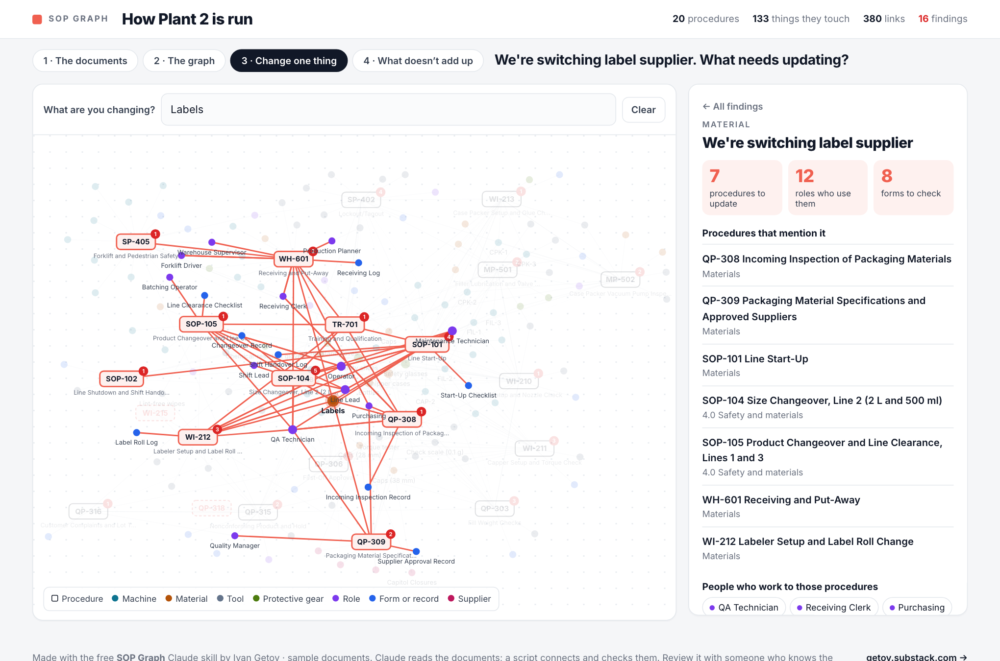
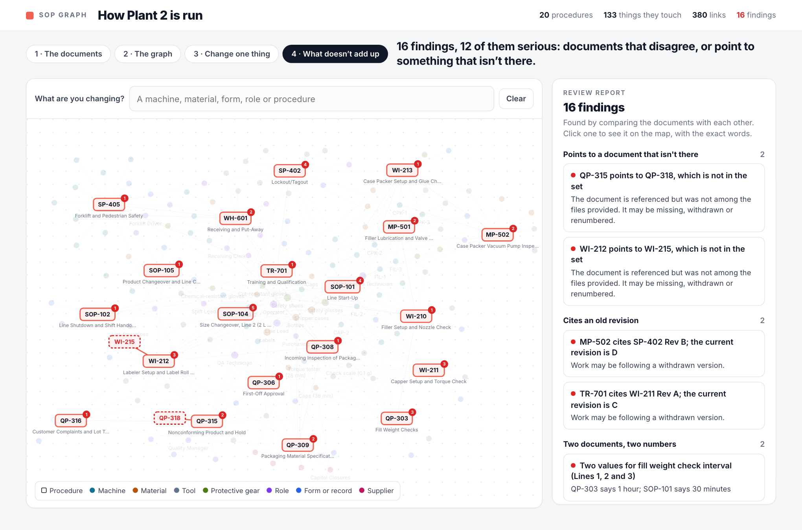

# SOP Graph

**Turn a folder of procedures into a map of how your plant is run. Type what you're changing and see every procedure, form and role it touches.**

**[Live example →](https://ivanegetov-lab.github.io/sop-graph/examples/plant-2/out/graph.html)**

A free Claude skill. Procedures get written one at a time, by different people, in different years, and nobody sees how they connect. This skill reads the whole set (PDF or Word, digital or scanned) and builds one knowledge graph from it.


The [MP4 version](video/sop-graph-demo.mp4) (1080×1350) is recorded from the real page by `node video/record.mjs`.

## What you get

1. **An interactive map** (`graph.html`). Every procedure and the machines, materials, tools, roles, forms and other procedures it touches. Type a change ("labels", "CAP-2", "QA Technician") and the path lights up, with the exact step and wording from each document.
2. **A plant summary** (`plant-summary.md`) to give an AI assistant as context: who does what, which documents cover which machine, every setting and limit, and where the documents disagree.
3. **The full graph** as JSON and as a SQLite database you can query.
4. **A review report** (`qa-report.md`): contradictions, references to documents that aren't there, old revisions still being cited, people with jobs in procedures they aren't trained on, and everything Claude was unsure about.

## What the example found

The example set is 20 procedures (42 pages) for [Plant 2](https://github.com/ivanegetov-lab/plant2-dataset), a fictional packaging plant with an open dataset. **The documents were written for this example, with problems planted in them. You can feed it your own.** A fresh Claude session, following only the instructions in this repo, read the PDFs and found every planted problem, plus a few that weren't planted:

| Finding | What the documents say |
|---|---|
| Two torque values for one cap | The capper instruction says 17 in-lb, raised after leak complaints. The changeover procedure still says 15. The training list still names the old revision. |
| Two answers to "who may change the fill setpoint" | One document lets operators adjust it by 2 g. A newer one says operators must not touch it. |
| A critical check nobody does | The specification makes label liner thickness critical on every lot. The incoming inspection procedure doesn't measure it. |
| A lockout method that was withdrawn | A maintenance procedure tells technicians to use the group lock box. The current lockout procedure removed it. |
| Dead references | Two procedures point to documents that don't exist. |

16 findings in all, from 380 links between 20 procedures and 133 things they touch. All 136 quotes were checked word for word against the PDF text. It also correctly left alone one planted trap: two vacuum limits that look like a conflict but are measured at different points.





## How it works

1. **Claude reads every document** and writes down what it says: roles, machines, materials, tools, forms, cross-references, every number someone is told to hit, and every rule about who may do what. Each item carries the place and a word-for-word quote.
2. **A Python script connects and checks.** It merges the extractions into one graph, compares the documents with each other, and checks every quote against the document text.
3. **Claude rules on what the script puts side by side** (is this a real conflict or two different things?) and looks for gaps a script can't see.
4. **The script builds the outputs.** No server, no login. Your documents stay on your computer.

The graph still needs review by someone who knows the plant, most of all where a document was scanned or unclear. The report lists everything Claude wasn't sure about so you know where to look.

## Try it

You need [Claude Code](https://claude.com/claude-code) and Python 3. Page images and quote checking also need [poppler](https://poppler.freedesktop.org/) (`brew install poppler`); the skill works without it.

```bash
git clone https://github.com/ivanegetov-lab/sop-graph ~/.claude/skills/sop-graph
```

Then, in Claude Code, from a folder with your procedures:

```
/sop-graph
```

or just ask: *"Map these procedures and tell me where they disagree."*

To rebuild the example from the extractions in this repo:

```bash
sh build_example.sh     # writes examples/plant-2/out/
sqlite3 examples/plant-2/out/graph.db "select src, quote from edges where dst='CAP-2'"
```

## What's in the repo

- `SKILL.md`: the instructions Claude follows.
- `scripts/sop_graph.py`: the merge, the checks and the builder. Python standard library only.
- `assets/viewer.html`: the map page.
- `references/schema.md`: the extraction format.
- `examples/plant-2/procedures/`: the 20 sample PDFs. `examples/plant-2/work/`: what Claude extracted and ruled. `examples/plant-2/out/`: the finished outputs.

## Limits

- It reports what the documents say, not what people do on the floor.
- A conflict is only found if both documents state the thing. A rule that lives in someone's head isn't in the graph.
- Scanned or handwritten pages are read less reliably. Check the "unsure" list.
- The example plant is made up. The documents are realistic, but they aren't real.

## More

- [Plant Pulse](https://github.com/ivanegetov-lab/plant-pulse): weekly plant numbers to a one-page review and a 5-slide deck.
- [Line simulator](https://github.com/ivanegetov-lab/line-sim): test a fix on your production line before you pay for it.
- [Plant 2 dataset](https://github.com/ivanegetov-lab/plant2-dataset): 13 weeks of open data from one fictional plant.
- [The Floor Report](https://getov.substack.com): weekly notes from the plant floor.

MIT license. Built by [Ivan Getov](https://www.linkedin.com/in/ivan-getov-mba/).
